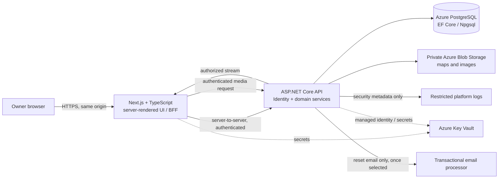

# Worldbuilding Wiki — Pre-Build Architecture and Security Plan

**Status:** Planning draft  
**Scope:** Private, owner-only worldbuilding wiki. Author Studio remains deferred.  
**Hosting direction:** Microsoft Azure is the provisional target.  
**Important:** This is an architecture and compliance planning document, not legal advice or a guarantee of legal compliance. Confirm jurisdiction-specific obligations before launch.

## 0. Repository audit and planning status (2026-10-22)

The repository currently contains a README, this planning document, and a Codex prompt batch. It contains no application source, migrations, deployment configuration, story-note source files, or repository-specific `AGENTS.md`. The README describes story concepts and intended product behavior, but it is not a substitute for the author's source notes. No implementation or live data flows have been verified. The diagrams, inventories, and architecture below describe the proposed first release, not a deployed service. Treat story-specific field and taxonomy details below as planning input from the README and prompt batch until checked against the source notes.

## 2A. Current-state architecture and proposed component/data flow

### Current state

There is no running application in this repository. The stack and Azure topology in this plan are proposed decisions, not existing components. The repository itself stores only documentation; no story content, credentials, media, or production configuration were found in the project file inventory.

### Proposed first-release flow

Browser requests use one HTTPS origin. The browser must not receive database credentials, blob credentials, API bearer tokens, or public blob URLs. The frontend gateway forwards requests to an API with internal ingress. The API is the final authorization boundary for every resource. Images/maps are streamed only after authorization. Password-reset messages may contain a short-lived, single-use reset link; story content is never sent to email, logs, analytics, or external AI. Exact Azure products, network topology, and email processor remain subject to the open-decision register.

## 6A. Domain model and entry/category schema

Use relational, typed core records and explicit typed values for extensible fields; do not store an entire entry as an opaque JSON document. Proposed entities and principal relationships:

| Entity | Key fields / relationships | Lifecycle and constraints |
|---|---|---|
| OwnerAccount | id, normalized email, password hash, MFA state, created/updated timestamps | One manually provisioned account initially; no registration endpoint. TOTP secret protected at rest; recovery codes stored as one-way hashes and consumed once. |
| Category | id, stable key, display name, protected flag, archived/deleted timestamps | Seed 13 protected categories. Protected category identity cannot be deleted; display name/layout may be customized subject to review. |
| CategoryTemplate | category id, template version, default field definitions | Seeds starter structure while allowing future schema evolution. |
| FieldDefinition | id, category id, stable key, label, value type, required flag, searchable/filterable/sortable flags, order, options | Value type is one of text, rich text, number, date, checkbox, dropdown, entry link, image/gallery. Validate options and values by type. |
| Entry | id, category id, title, summary, body/content blocks, universal date fields where applicable, status, created/updated timestamps | Common tags, images, body, links and revision history. Archive is recoverable; permanent deletion semantics remain undecided. |
| FieldValue | entry id, field definition id, typed value columns or typed subtype | Enforce one value representation matching field type; index only approved searchable/filterable values. |
| ContentBlock | entry id, ordinal, block type, validated structured payload | Constrained headings/text/image-gallery/entry-link schema; no arbitrary executable HTML. |
| Tag / EntryTag | tag id/name; entry id/tag id | Private taxonomy; uniqueness normalized per agreed rule. |
| EntryRelationship | source entry id, target entry id, relationship type, optional label/direction | Typed links and backlinks; enforce both endpoints exist and are visible to the owner. |
| MediaAsset | id, private object key, detected media type, dimensions, size, checksum, alt/caption, created timestamp, deletion state | Random storage name; no public URL. Entry references are separate so removing a reference does not delete the asset. |
| Revision / AuditEvent | entry id/revision number/snapshot or delta, actor, event type, timestamp | Owner-only history for edits, archive/restore, category/layout changes and deletion events. Never include secrets in event details. |
| UniversalDate / EventDetails | entry id, start/end fictional year, certainty, optional era label | Numeric fictional chronology, not Gregorian date conversion. Event remains a normal lore entry. |
| MapSet / MapLayer / MapMarker | map set era label; base and overlay media refs; layer type; normalized coordinates; linked Location entry | One base and one selected overlay per map set; overlays dimension-match base; marker links remain referentially valid. |
| WeavingBranch / WeavingSubbranch | fixed branch key/name; parent branch id for subbranches | Matter, Energy, Fields, Light, Shadow are protected. Subbranches are configurable; seed from notes when verified. |

Seed protected categories: Characters, Locations, Nations/Civilizations, Cultures, Species, Religions, Factions/Groups, Artifacts, Weaving, Languages, Events, Terms, Technologies. Starter fields and Weaving subbranches are specified in the README/prompt batch; reconcile them against the unavailable source story notes before seeding production data. Keep user-created category/field removal as archive when values or links exist. Referential integrity, revision retention, and media reference handling must be covered by migrations and model tests.

## 5A. Threat model and security/privacy requirements

| Threat / asset | Main failure mode | Required controls and verification |
|---|---|---|
| Account takeover: password, TOTP, recovery codes, session | Credential stuffing, phishing, stolen device, reset abuse | Required TOTP, strong password hashing, one-time hashed recovery codes, throttling/lockouts, generic reset responses, session rotation/revocation, no SMS; test login/MFA/reset and replay. |
| Unauthorized access to lore and metadata | Missing checks on a page, API, search snippet, graph, timeline, archive, export or media | Deny-by-default authorization at API and frontend; internal API; authenticated media streaming; enumerate resource classes in negative tests. |
| Stored XSS / CSRF | Malicious rich text or cross-origin mutation | Constrained content schema, server validation/sanitization, output encoding, CSP, anti-forgery tokens and SameSite; test payloads and cross-site state changes. |
| Malicious or identifying uploads | MIME spoofing, oversized/decompression abuse, EXIF leakage, unsafe parser | Raster allowlist, signature checks, size/dimension/pixel limits (values TBD), random keys, metadata stripping, safe thumbnails, private storage; test malformed and boundary files. |
| Cloud/service credential compromise | Exposed secrets, overprivileged identity, public database/blob | Managed identity, Key Vault, least privilege, private networking, no public blob access, TLS/encryption, secret scanning and access review. |
| Accidental deletion / ransomware / provider failure | Loss of database, files, history or recovery credentials | Approved backup baseline, separate encrypted copies, restore drill, deletion runbook; verify database and media restore together. |
| Logging/processor disclosure | Story text, tokens, IP/security metadata or content sent to vendor | Minimize logs, redact secrets and request bodies, restricted access/retention, no analytics/ad trackers/AI; verify log fields and processor configuration. |
| Denial of service / brute force | Login or upload resource exhaustion | Rate limits, bounded request/body sizes, upload limits, resource monitoring and alerting; test throttling and limits. |

Security baseline: HTTPS/TLS, HSTS, restrictive CSP, safe referrer/content-type headers; parameterized EF queries; input validation and output encoding; anti-forgery on mutations; secure host-only HttpOnly cookies; private DB/blob; encrypted storage; no indexing directives as a substitute for authorization. Security events may record time, event category, outcome and minimal correlation metadata, but not passwords, TOTP/recovery/reset/session tokens or story content. IP retention and precision are undecided and should be minimized.

## 4A. Data, cookie, retention/deletion, and processor inventories

| Data | Purpose / proposed location | Access and retention |
|---|---|---|
| Owner email, password hash, TOTP/recovery state | Authentication database | Owner/auth service only. Account lifetime; deletion procedure and recovery implications need decision. |
| Session and anti-forgery identifiers | Browser cookie and server session store (implementation choice TBD) | Necessary security state; idle and absolute lifetime TBD; revoke on logout/password or MFA changes. |
| Story entries, custom values, tags, links, revisions | PostgreSQL | Owner only. Retain while account/content exists; archive vs permanent deletion policy TBD. |
| Images and maps, metadata, thumbnails, map markers | Private blob plus database references | Owner-only authorized delivery. Reference removal preserves asset; explicit purge and backup expiry need decision. Strip EXIF. |
| Security/operational logs | Restricted Azure logging service, if selected | Minimize and redact. Retention duration, IP handling and access roles TBD. No story bodies. |
| Backups | Encrypted private Azure backup location | Current baseline: PostgreSQL PITR 35 days; monthly DB/media copies 12 months; blob soft delete 30 days and bounded version history. Backup purge follows expiration unless a separate supported purge is selected. |
| Reset email address and single-use reset link | Selected transactional email provider | Only when reset requested; provider retention and data region must be reviewed; do not include lore or credentials. |

**Cookie inventory (proposed):** authentication/session cookie (Secure, HttpOnly, host-only, SameSite=Lax or Strict; exact name, persistence and lifetime TBD); anti-forgery cookie/token if the selected framework flow requires one (not an authentication credential; exact transport TBD). No analytics, advertising, personalization, or third-party embed cookies are planned. Confirm actual cookies from a browser inspection before writing final notice; do not claim none beyond the verified inventory.

**Processor register (provisional):** Microsoft Azure for compute, database, object storage, Key Vault, and possibly logs/backups; transactional email provider not selected. No external AI, analytics, ad tracking, external search, or third-party media processing is approved. Azure product configuration, region, subprocessor terms, and email-provider terms/data location require review before production. Update this list from actual deployed services.

**Deletion and retention rules:** archive is reversible and distinct from permanent deletion. Entry deletion semantics (tombstone vs hard delete), revision/audit handling, linked-entry behavior, account deletion, media purge, and backup treatment are open decisions. Removing an entry's media reference must not delete the shared asset. Existing backup baseline implies old copies expire on schedule; immediate erasure from immutable/retained backups must not be promised. Document a user-visible deletion workflow and actual purge timetable after decisions are approved. Export format and scope also require definition before launch.

## 8A. Architecture decisions, implementation phases, and test gates

### Decision record

| ID | Decision | Status / rationale |
|---|---|---|
| ADR-001 | Next.js + TypeScript UI, ASP.NET Core + C# API, PostgreSQL + EF Core/Npgsql | Agreed stack. |
| ADR-002 | Azure is provisional host; Container Apps, PostgreSQL Flexible Server, private Blob, Key Vault are proposed services | Direction agreed; exact region, topology and spend not approved. |
| ADR-003 | Single owner, manually provisioned; disable registration; password + required TOTP and offline one-time recovery codes; no SMS | Agreed first-release boundary. |
| ADR-004 | Single HTTPS origin with Next.js server gateway to internal API; API enforces final authorization | Recommended architecture; validate deployment and CSRF/session flow during design. |
| ADR-005 | No analytics/ad tracking or external AI processing | Agreed. |
| ADR-006 | Protected starter categories and five Weaving branches; extensible typed fields; universal fictional-year timeline | Agreed product direction; reconcile seed details with source story notes. |
| ADR-007 | Author Studio, themes, subplots deferred | Agreed scope boundary. |
| ADR-008 | PostgreSQL PITR 35 days; media soft delete 30 days; encrypted monthly separate copies for 12 months | Approved planning baseline; cost and restore tests remain. |

### Phased plan and evidence

| Phase | Work | Minimum verification gate |
|---|---|---|
| 0. Planning approval | Resolve or explicitly accept open decisions; inspect source notes; approve data model, topology, retention, notice facts | Architecture review; decision register signed/dated; no legal-compliance claims. |
| 1. Foundation | Separate frontend/API, local config, migrations, health checks, CI, secrets patterns | Build/lint/type checks; migration applies to clean PostgreSQL; no secrets in repo. |
| 2. Authentication/private boundary | Owner bootstrap, password/TOTP/recovery, reset email, session/CSRF/rate limits, authorization | Auth flow and lockout tests; unauthenticated denial across all endpoints/resources; cookie inspection. |
| 3. Domain/schema | Protected categories, typed fields, entries/links, universal dates, revisions/archive | Migration/model constraints and seed tests; referential integrity; archive/restore tests. |
| 4. Entry editing/media | Safe editor, categories/fields, private upload library, authenticated delivery | XSS/upload validation/media authorization tests; file limits and EXIF behavior verified. |
| 5. Search/history/graph/timeline/atlas | Private derived views and map features | Authorization and leakage tests for each data path; fictional year, layer/marker integrity tests. |
| 6. Operations/release | Azure hardening, backups, logs, alerts, recovery and factual notices | Dependency/secret scan; full DB+media restore drill; launch checklist and rollback runbook. |

Tests are planned verification gates, not yet run: this repository has no application to test. Each phase should add focused unit/integration tests and report actual evidence. Do not mark launch-ready until phase 6 gates pass.

## 9A. Open-decision register

No item below is resolved by this plan. Recommendations are planning suggestions, not facts or legal conclusions.

| ID | Decision / recommendation for review | Owner / needed by |
|---|---|---|
| O-01 Jurisdiction | Confirm owner's residence and any intended future users. Recommendation: use the owner's actual jurisdiction as the initial review baseline; obtain qualified review for applicable obligations before launch. | Owner, before legal notice/final deployment |
| O-02 Azure region | Select region based on jurisdiction, latency, availability, provider terms and cost. Recommendation: choose a region near the owner only after data-location implications are reviewed; use the same approved region for core services where practical. | Owner, before provisioning |
| O-03 Budget | Set monthly ceiling including compute, database, storage, backups, logs, egress, domain and email. Recommendation: price a minimal always-on and a low-cost/paused-development profile before selecting SKUs. | Owner, before provisioning |
| O-04 Domain/DNS | Choose domain, registrar/DNS host, ownership account, renewal and recovery controls. Recommendation: use an owner-controlled domain and MFA-protected registrar; avoid publishing an open registration surface. | Owner, before production |
| O-05 Email delivery | SMTP transport is implemented; choose provider/account and sender domain, then verify delivery, region, retention, security and terms. Recommendation: authenticated sending (SPF/DKIM/DMARC) and no marketing list. | Owner, before provisioning/production |
| O-06 Session lifetime | Provisional code defaults are 30-minute idle and 8-hour absolute lifetime, non-persistent. Confirm idle/absolute lifetime and reauthentication threshold. Recommendation: bounded lifetimes and revocation on credential/MFA changes. | Owner/security review, before production |
| O-07 Log retention | Set security and platform log retention, IP precision, access roles and alerting. Recommendation: retain only minimal security metadata for a documented short period compatible with incident response; do not log story content. | Owner, before production |
| O-08 Upload limits | Set per-file bytes, dimensions/pixel count, allowed image formats and total storage budget. Recommendation: PNG/JPEG/WebP only, conservative bounds, explicit validation and thumbnail limits; choose values after evaluating expected map sizes and monthly cost. | Owner, before media implementation |
| O-09 Permanent deletion | Decide entry/account/media purge, history/audit retention, linked references, exports, backup expiration and restore behavior. Recommendation: separate reversible archive from explicit confirmed purge; disclose that retained backups expire on schedule unless immediate purge is technically supported and verified. | Owner, before deletion UI/legal notice |
| O-10 Story-note reconciliation | Provide/identify authoritative story notes and confirm starter fields, names, dates, and inspiration references. Recommendation: treat README/prompt values as provisional until cross-checked. | Owner, before seed/migration |
| O-11 Exact Azure topology | Confirm Container Apps/internal ingress, database private networking, storage access, secrets, logs and backup products. Recommendation: no public DB/blob; managed identity and private service access. | Owner/implementation, before infrastructure code |
| O-12 Cookie/session implementation | Identity protected ticket and double-submit antiforgery cookies are implemented with Secure/host-only/Path `/`/SameSite=Strict; the session is HttpOnly and CSRF cookie is readable. Confirm browser behavior and final notice wording. | Owner/implementation, before notice |
| O-13 Export and account recovery | Decide owner data export format and recovery if TOTP device and all recovery codes are lost. Recommendation: documented manual identity-verified recovery with audit event; avoid hidden bypass codes. | Owner, before launch |

**Legal text gate:** Prepare only factual placeholders until implementation confirms actual data collected, processors, region, cookies, retention/deletion, contact route, and recovery behavior. Any final notice requires jurisdiction-specific review; do not state that the service is compliant or that a consent banner is legally unnecessary based solely on this plan.

## 1. Product and privacy boundary

- One owner account at launch. No public registration and no invited users initially.
- Every wiki page, API operation, search result, graph, timeline, map, image, and download requires authentication.
- The unauthenticated surface is limited to the login and account-recovery screens. Robots directives and no-index headers are defense in depth; authorization is the actual privacy control.
- No analytics, advertising trackers, third-party AI processing, or public publishing in the first release.
- Author Studio features, including themes and subplots, stay deferred. Story lore pages and linked world entries remain in scope.

## 2. Agreed stack and deployment shape

- Frontend: Next.js and TypeScript.
- Backend: ASP.NET Core and C#; ASP.NET Core Identity for email/password authentication and required TOTP MFA.
- Data: PostgreSQL with EF Core and the Npgsql provider.
- Hosting direction: Azure Container Apps for the frontend and API; Azure Database for PostgreSQL Flexible Server; private Azure Blob Storage for images and maps; Key Vault for secrets.
- Recommended network shape: one HTTPS browser origin. The frontend acts as a server-side gateway to an API with internal ingress. The database and blob storage are not publicly readable. Use managed identities for service access and keep secrets out of source control.
- Keep development, staging, and production resources separate. Test with synthetic lore in non-production environments.

## 3. Authentication and session requirements

- Provision the initial owner account through a one-time setup process. Disable that setup path after the account exists.
- Require TOTP after password authentication. Provide one-time recovery codes; store only protected/hashed recovery material. No SMS fallback.
- Disable self-service registration. Password recovery uses a verified email address, short-lived single-use reset links, rate limits, and generic responses that do not reveal whether an address is registered.
- Rate-limit login, MFA verification, password reset, and recovery-code attempts. Apply progressive lockouts and alert on repeated failures.
- Store session identifiers only in server-managed cookies, never browser local storage. Cookies must be Secure, HttpOnly, host-only, and SameSite=Lax or Strict as the chosen flow permits. Add anti-forgery validation to state-changing requests; SameSite is an additional defense, not a replacement for CSRF protection.
- Rotate the session after login and MFA, expire it after inactivity, and require reauthentication for sensitive actions such as changing credentials or disabling MFA.
- Do not log passwords, TOTP secrets, recovery codes, session cookies, reset tokens, or story content.

### Implementation baseline added in the private-access phase

- ASP.NET Core Identity uses the PostgreSQL EF store. Only the data-protection and authenticator token providers are registered; there is no phone/SMS provider or registration endpoint.
- The bootstrap endpoint requires a configured one-time setup key and an empty owner table. It sends an email confirmation link before TOTP enrollment; the link token is placed in the URL fragment so it is not sent in the HTTP request. Once the owner has confirmed email and enabled TOTP, the setup page is closed. Password reset is available only for the verified address.
- The `__Host-wiki-session` cookie is Secure, HttpOnly, host-only, Path `/`, and SameSite=Strict. It carries the ASP.NET Identity protected ticket. Provisional expiration is 30 minutes idle with an 8-hour absolute maximum; change only after owner review.
- The temporary `__Host-wiki-mfa` cookie is also Secure, HttpOnly, host-only, Path `/`, and SameSite=Strict, with a five-minute non-sliding lifetime during the password-to-TOTP step.
- The `__Host-wiki-csrf` cookie is Secure, host-only, Path `/`, SameSite=Strict, and intentionally readable by the browser for the double-submit antiforgery token flow. All state-changing API requests require the antiforgery header.
- Password/MFA failures use Identity lockout (five failures, 15-minute lockout) plus an IP-keyed API auth limiter (20 requests per five minutes). Reset and email confirmation tokens use a 15-minute lifetime. Security-stamp validation runs every minute; successful password changes/resets update the stamp so prior sessions expire after validation.
- Identity token-table values, including authenticator/recovery material, are encrypted with ASP.NET Data Protection through an EF value converter. Production must provide a durable, access-controlled Data Protection key ring; that infrastructure is not configured in this phase.
- The Next.js gateway proxies `/api/*` and validates protected page sessions through the authenticated API session endpoint. API fallback authorization requires an authenticated owner unless an endpoint is explicitly anonymous. Anonymous routes are limited to login/bootstrap/recovery/CSRF and non-content health checks.
- Email delivery is implemented as configurable SMTP with TLS. No provider/account has been selected. Owner bootstrap and password recovery remain unavailable until a verified sender and working delivery configuration are supplied.
- The API trusts forwarded scheme/address headers only from loopback and configured proxy IPs. Configure exact production proxy addresses before deployment; no production ingress has been set up.

## 4. Cookies, privacy, and legal materials

### Cookie decision

Use only cookies needed for authentication, session protection, and anti-forgery. Do not add analytics, ad, personalization, or third-party tracking cookies by default. Provide a concise cookie/privacy notice describing each necessary cookie and its purpose. With no optional tracking, do not add a consent banner by default; reassess if tracking or external embeds are introduced. Strictly necessary cookies are generally exempt from prior consent under EU ePrivacy rules, but national implementation and the user's jurisdiction matter.

### Data inventory and notice

Document the data the service handles: account email, password hash, TOTP/recovery state, security-event metadata, wiki entries, images/maps, edit history, and backups. Identify Azure and the email-delivery provider as processors when selected. State the purposes, retention, deletion/export path, hosting region, and contact method in a privacy notice. The notice must match the actual implementation.

For owner-only use, keep legal copy proportionate and accurate. If additional users are introduced, pause and review privacy notices, user rights, account deletion, terms, and processor arrangements before enabling their accounts. Applicability of laws such as California's CCPA depends on the service and business meeting legal scope requirements; do not assume every private site needs the same banner or opt-out controls.

### Content and intellectual property

- Require that uploaded maps and images are owned by the user or licensed for their intended use.
- Keep references to existing franchises as private inspiration notes. Use original text, characters, names, maps, and images before sharing or publishing. The working notes mention Avatar/ATLA, Black Panther, and LOTR; flag those references for an IP review before any public release.
- Do not import copyrighted passages or third-party images without permission. Keep a source/rights note for externally sourced reference material.

## 5. Application and data security

- Enforce authorization in both the Next.js server layer and every ASP.NET Core endpoint. Search, graph, timeline, exports, thumbnails, and archived revisions use the same access checks.
- Serve media through an authenticated route or a narrowly scoped, short-lived link. Never expose public blob URLs or put sensitive content in URLs.
- Use HTTPS everywhere, current TLS, HSTS, a restrictive Content Security Policy, and appropriate referrer/content-type headers.
- Rich text is rendered from a constrained editor schema and sanitized on the server. Prevent stored XSS; do not permit arbitrary scripts or unsafe embedded HTML.
- Validate uploaded image type by file signature as well as declared MIME type. Allow only required raster types (PNG, JPEG, WebP) at launch; set file-size and image-dimension limits; generate safe thumbnails; strip EXIF metadata; use random storage names; scan uploads where available.
- Use parameterized database access, input validation, anti-forgery defenses, output encoding, and rate limits. Keep database credentials and encryption keys in Key Vault or managed identity-backed configuration.
- Encrypt connections in transit and stored data at rest. Restrict database networking to the application; deny anonymous blob access; apply least-privilege roles.
- Log security and administrative events (login/MFA failures, credential changes, restores, archival, deletion, and access-control changes) without logging lore text, image contents, secrets, or tokens. Set a defined log retention period before launch.
- Search index, graph layout state, and generated thumbnails are private derived data and must not bypass entry permissions.

## 6. Content model and product behavior

### Protected starter categories

Characters; Locations; Nations/Civilizations; Cultures; Species; Religions; Factions/Groups; Artifacts; Weaving; Languages; Events; Terms; Technologies. The base categories and five Weaving branches cannot be removed. Names and layouts can be customized according to the agreed template rules; user-added categories, fields, and subbranches can be removed, with data archived when necessary.

Common entry support: title, summary, images, rich-text body, tags, linked entries, custom fields, and entry history. Custom fields can be marked searchable, filterable, and sortable.

### Weaving and story-specific structure

Fixed branches: Matter, Energy, Fields, Light, Shadow. Subbranches are addable/removable. Seed the hierarchy from the user's notes, including Earth > Metal; Water, Air, Organic matter; Heat, Motion, Chemical reactions, Nuclear energy, Pure energy; Gravity, Magnetism, Electricity, Force manipulation; Illumination, Lasers, Optical illusions; Concealment, Darkness manipulation, Shadow constructs, Supernatural shadow travel.

Technology entries cover type, era, creator, operation, compatible Weaving disciplines, uses/limits, and social impact. Nation entries cover region, language/dialect, imports/exports, economy, entry/exit laws, dominant conduit type, groups, maps, and conflicts. Political groups have their own linked lore entries. Character entries support aliases, nation/culture, universal birth/death years, affiliations, relationships, Weaving and conduit information, and Avatar/Marked status. Events are lore entries with universal start/end years, date certainty, nation-era labels, locations, people/groups, and consequences.

### Search, graph, timeline, and atlas

- Global search covers title, summary, body, tags, and custom fields explicitly marked searchable. Filters use category, tags, and filterable fields.
- Sigma.js and Graphology power the relationship graph only. Provide focused and full-universe views; graph data inherits wiki access checks.
- One shared timeline is ordered by universal year. Nation-specific eras are optional date labels within that timeline. Event entries open their own lore pages; multi-year events render as bars. Approximate dates are represented as approximate.
- Atlas uses uploaded images created elsewhere. It supports multiple map sets with an era selector and map-type selector. The base image stays visible; one overlay type is shown at a time: territory, terrain, roads/infrastructure, or population density. Each overlay matches its base image dimensions. Markers link to Location entries. Past and modern map sets are separate.
- Keep history in Settings. Record entry edits, category/layout changes, archivals, restores, and deletions. Preserve revisions for review/restore; media removal from an entry removes the link, not the file, unless the file is explicitly deleted.

## 7. Backup, retention, and recovery

Approved baseline:
- PostgreSQL point-in-time recovery: 35 days.
- Media: private storage with 30-day soft-delete recovery and bounded version history.
- Encrypted monthly database-and-media copy in a separate private backup location: 12-month retention.
- Test database and media restoration before launch and periodically afterward.
- Define separate retention for security logs and permanent content deletion before production. History/archives and disaster-recovery backups are distinct controls.

## 8. Operations and release gates

Before production:
1. Confirm owner jurisdiction/state, Azure region, budget ceiling, domain, and email-delivery provider.
2. Finalize privacy/cookie notice and content-rights language against actual data flows; review legal wording for the applicable jurisdiction.
3. Complete a threat model covering credential theft, unauthorized crawlers, private-media leakage, malicious uploads, cross-site request forgery, stored script injection, cloud credential compromise, and accidental deletion.
4. Verify unauthenticated access fails for every page, API, search result, graph/timeline data source, image, map layer, and export. Confirm no indexing or public blob access.
5. Run dependency/secret scans and security tests for MFA, lockouts, password reset, CSRF, rich-text rendering, file uploads, authorization, and restore workflows.
6. Confirm restore points and perform a recovery exercise. Prepare an incident runbook for session revocation, credential rotation, account recovery, and data restoration.
7. Review accessibility and keyboard support for the wiki editor, graph, timeline, and map selectors.

## 9. Open decisions before implementation

- Confirm the exact jurisdiction for the owner and any future users; U.S. is the planning baseline for now.
- Choose Azure region, acceptable monthly cost, domain/DNS, and transactional email provider.
- Set exact session idle/maximum lifetime and security-log retention.
- Decide permanent deletion behavior for entries and history, and whether backups are purged immediately or expire on the approved schedule.
- Confirm image upload size/dimension limits and whether the selected email provider supports reliable password recovery.
- Keep invitation-only accounts disabled until a future review updates the privacy, legal, and access model.

## Reference points

- [OWASP Session Management Cheat Sheet](https://cheatsheetseries.owasp.org/cheatsheets/Session_Management_Cheat_Sheet.html)
- [OWASP CSRF Prevention Cheat Sheet](https://cheatsheetseries.owasp.org/cheatsheets/Cross-Site_Request_Forgery_Prevention_Cheat_Sheet.html)
- [EU ePrivacy Directive, Article 5(3)](https://eur-lex.europa.eu/eli/dir/2002/58/art_5/par_3/oj/eng)
- [California Attorney General: CCPA overview](https://www.oag.ca.gov/privacy/ccpa)
- [Azure PostgreSQL backup and restore](https://learn.microsoft.com/en-us/azure/postgresql/backup-restore/concepts-backup-restore)
- [Azure Blob soft delete](https://learn.microsoft.com/en-us/azure/storage/blobs/soft-delete-blob-overview)
- [Azure Blob versioning](https://learn.microsoft.com/en-us/azure/storage/blobs/versioning-enable)
